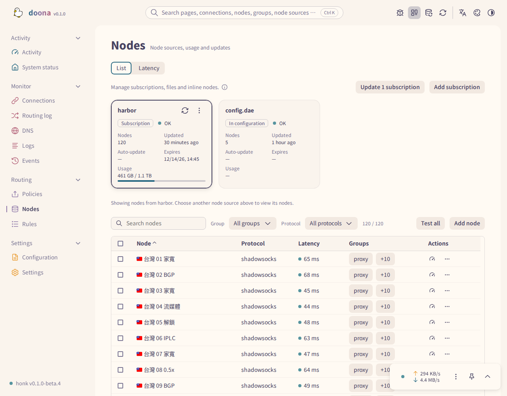
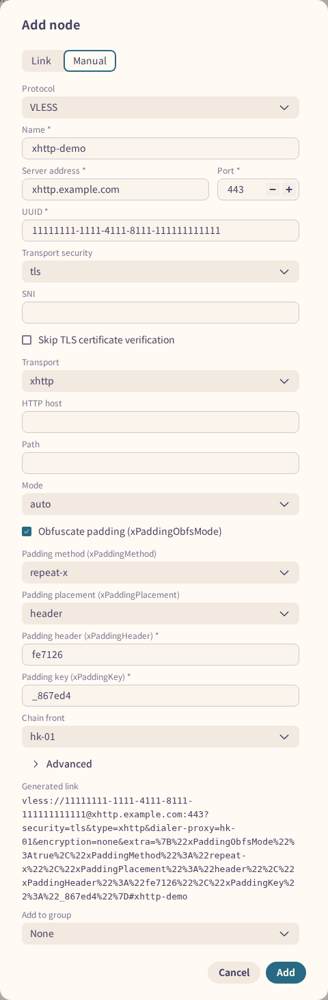
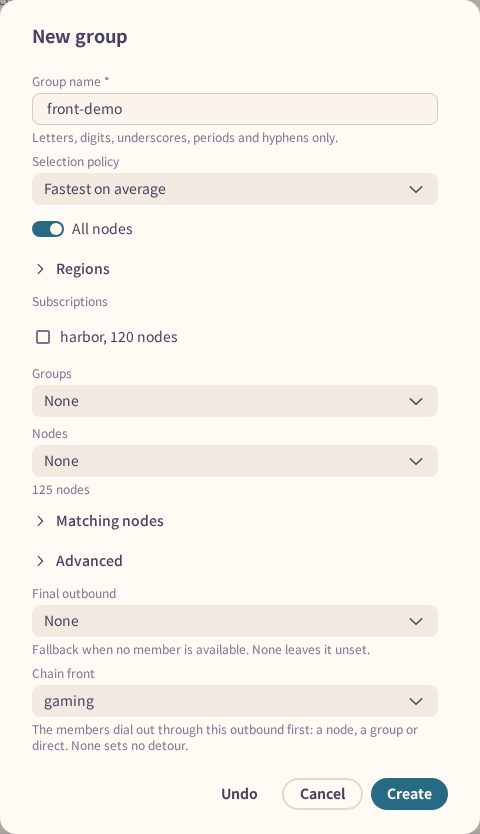

<div align="center">

# honk

**An experimental transparent-proxy engine for Linux, written in Rust.**

**[Documentation](doc/README.md)** / **[Web UI demo](https://demo.daeuniverse.org/)** / **[Releases](https://github.com/6106757-lab/honk/releases)**

English / [简体中文](README.zh.md)

[Capabilities](#capabilities) / [Fork additions](#fork-additions) / [Install](#install) / [Configuration format](#configuration-format) / [Web interface](#web-interface) / [Report problems](#report-problems)

</div>

> **Early alpha, not recommended for production.** Expect breaking changes, incomplete features, and limited real-world validation.

honk follows the design of dae's eBPF datapath and configuration syntax, and of sing-box's outbound groups and Clash API. It is an independent implementation, not a port of either project. This repository is a fork of [daeuniverse/honk](https://github.com/daeuniverse/honk) that adds MASQUE outbound, chained proxies (detour), and a customized doona UI; see [Fork additions](#fork-additions).

## Capabilities

### Transparent proxy

- TC eBPF, `dae0`/`daens`, and compiled routing handle LAN-forwarded and host-originated TCP/UDP.
- Domain sniffing (`dial_mode: domain` / `domain+` / `domain++`) with destination-IP verification, re-running routing on the sniffed name.
- Ambiguous LAN UDP is held in NFQUEUE 320 for a verdict (`global.nfqueue_enable`, on by default).
- Requires root, Linux 6.12+, the required kernel options, and bpffs.

### Outbound protocols

SOCKS5, Shadowsocks/2022, Trojan, AnyTLS, Hysteria2, TUIC, Juicity, VMess, VLESS, `direct`, `block`, plus MASQUE (connect-ip) from this fork (see below).

- Trojan / VMess / VLESS support H2 XHTTP (`packet-up`, `stream-up`, `stream-one`).
- XHTTP supports obfuscation-padding import and sending, interoperable with Cloudflare edgetunnel-style entries; the WS / XHTTP Host is used as the TLS SNI when no explicit `sni` is set.
- VLESS supports REALITY, Vision (`xtls-rprx-vision`), XUDP, and multiplexing; VMess supports true command-UDP (one association per destination).
- Fronted QUIC receive cap is 1452 bytes; DoT (853) takes the LAN-protection path and never goes through a proxy.

See [protocol limits](doc/en/reference/nodes.md).

### Group policies

Selector (the default), URLTest, LoadBalance, Fallback, and Score.

- Selector: pick a member by hand; TCP and UDP both follow the selected member.
- URLTest: probe latency on a schedule and pick the fastest member.
- LoadBalance / Fallback: balance load or fail over in order.
- Score: selection from business observations and bounded validation; see [group policies](doc/en/reference/groups.md#score-policy).
- Groups nest (`filter: group(X)`); `final:` sets the result when no selection qualifies.

### DNS

- Upstreams over UDP, TCP, DoT, DoH, DoQ, and DoH3, optionally through a node or group.
- Request and response routing plus caching (only NOERROR answers carrying an address for the queried family are cached; NXDOMAIN / SERVFAIL / NODATA are never cached, and expired positives serve stale for 1 hour).
- `ipversion_prefer`, `client_subnet` (`auto` or a fixed value), and bootstrap resolution.

### Configuration and control

- dae-syntax configuration (see [Configuration format](#configuration-format)), subscriptions, `include {}` splitting, and SIGHUP hot reload.
- A Clash-compatible REST / WebSocket API and a native API (`/api/v1`), plus the `honk-tool` CLI toolbox.
- An embedded doona web UI (in `full` builds) for live observation, diagnostics, and configuration editing.

There is no FakeIP engine, full mihomo parity, or Windows/macOS datapath.

## Fork additions

This fork adds features that upstream `daeuniverse/honk` does not ship. Upstream `main` does not contain them; this repository is maintained independently, and issues belong in [this fork's Issues](https://github.com/6106757-lab/honk/issues).

- **MASQUE (connect-ip) outbound**: import `type: masque` nodes from subscriptions (including Cloudflare WARP) over HTTP/2 or HTTP/3, with TUN devices and UI latency probes. See the [chained-proxy and MASQUE guide](doc/zh/guide/chained-proxy-and-masque.md).
- **Chained proxies (detour)**: nodes take `dialer-proxy` (Clash subscriptions / share links) or `detour` (sing-box JSON); groups take `detour:`, whose front can be a node, a group, or `direct`. A group front is resolved on every dial, so switching fronts takes effect on hot reload without a restart; `filter: group(X)` groups inherit the upstream group's detour, an explicit `detour:` (including `direct`) overrides it, and an unbound detour refuses the dial instead of silently going direct. TCP, UDP, and Clash / native-API latency probes share the same resolution.
- **XHTTP obfuscation padding**: import and send edgetunnel-style XHTTP padding fields (`xPaddingObfsMode/Method/Placement/Header/Key`), verified against a real edgetunnel.
- **Embedded customized doona UI**: `full` builds embed the [6106757-lab/doona](https://github.com/6106757-lab/doona) `v0.1.0` UI, which probes MASQUE nodes and lets you add XHTTP nodes by hand (including the 5 padding fields).
- **Prebuilt binaries**: [Releases](https://github.com/6106757-lab/honk/releases) ship compiled x86_64 and aarch64 musl `full` builds (tar.gz, deb, rpm, pkg.tar.zst); download and deploy, no local Rust toolchain needed.

## Install

Download a prebuilt archive from [this fork's Releases](https://github.com/6106757-lab/honk/releases). The published artifact is the x86_64 and aarch64 static musl `full` build (native API + Clash API + embedded doona / doona lite); it can be deployed as-is without a local Rust toolchain. The table below describes the upstream build matrix; only `full` is published here.

| Build | Native API | Clash API | Embedded doona and doona lite |
| --- | --- | --- | --- |
| `full` | Yes | Yes | Yes |
| `native-api` | Yes | No | No |
| `clash-api` | No | Yes | No |

Every build comes as a static musl binary; `full` also comes linked against glibc (`gnu`). Archives with `stock` in the name use the system allocator instead of jemalloc. Each release's Downloads section lists checksums and provenance.

For OpenWrt, use the [daeuniverse package feed](https://openwrt.daeuniverse.org/en/).

For source builds, follow [Build from source](doc/en/how-to-start.md#build-from-source). Release binaries embed eBPF; plain `cargo build --release` does not enable the real datapath.

Follow the [startup guide](doc/en/how-to-start.md) for kernel checks, installation, and connectivity verification. Initial deployment changes network hooks, namespaces, and sysctls; keep an out-of-band management path available.

## Configuration format

honk uses a dialect of the dae configuration syntax. A config is made of `section { ... }` blocks, one `key: value` per line. The full field lists live in the [configuration guide](doc/en/configuration.md) and the [reference docs](doc/en/reference/).

### Sections

| Section | Purpose |
| --- | --- |
| `global` | Interfaces, dial behaviour, health checks, runtime paths |
| `node` | Static proxy nodes, declared as share links |
| `group` | Selection across nodes and nested groups |
| `routing` | Ordered traffic rules and a default outbound |
| `dns` | Listeners, upstreams, request/response policy, caching |
| `subscription` | Remote node lists |
| `assets` | Download defaults for geodata, external UI, subscriptions |
| `experimental` | Native API, Clash API, persistent cache |

The built-in outbounds `direct` and `block` are injected at startup and can be used in groups and routing rules.

### Syntax rules

- Put settings in `section { ... }` blocks, one `key: value` per line. One-line blocks such as `global { log_level: debug }` and nested one-line blocks are also accepted.
- Quote URLs, values with whitespace, and values containing syntax characters such as `:`, `+`, or `#`. Scalar values and `include` / `node` entries accept single or double quotes; quoted `subscription` URLs use single quotes.
- Where a setting or matcher takes a list, separate items with commas: `lan_interface: eth0, eth1` or `dport(80, 443)`.
- Durations in seconds accept a bare number or an `ms`, `s`, `m`, `h` suffix. Millisecond settings such as `check_tolerance` accept a bare millisecond count, `ms`, or `s`.
- A `#` at the start of a token outside quotes starts a comment; a `#` inside a bare value stays data.
- Unknown scalar keys produce a diagnostic and are ignored; an unclosed block rejects the whole document.
- Split configuration with `include {}`, which supports `*`, `?`, `[]` glob patterns; relative paths resolve against the entry config's directory.

### Complete example

```dae
# Global: interfaces, dialing, health checks.
global {
    wan_interface: auto
    lan_interface: br-lan
    log_level: info
    log_file: 'honk.log'
    dial_mode: domain++
    auto_config_kernel_parameter: true
    data_dir: '/var/lib/honk'
    tcp_check_url: 'https://www.gstatic.com/generate_204'
    tcp_check_http_method: HEAD
    check_interval: 300s
    check_tolerance: 30ms
}

# Static nodes: share links; the tag becomes the routing/API name.
node {
    backup: 'socks5://192.0.2.2:1080'
    landing: 'vless://uuid@example.com:443?dialer-proxy=qianzhi#Landing'
}

# Subscription: a remote node list.
subscription {
    mysub: 'https://example.com/sub' {
        interval: 3600s
    }
}

# Groups: pick members, set a policy, (this fork) set a front.
group {
    qianzhi {
        filter: name('front-tw')
        policy: selector
    }
    Final {
        filter: name(keyword: 'WARP')
        policy: selector
        detour: qianzhi
    }
    Proxy {
        filter: group(Final)
        policy: selector
    }
}

# Routing: rules in order, fallback is the default outbound.
routing {
    dip(geoip: private) && !dport(53, 853) -> direct(must)
    domain(geosite: geolocation-cn) -> direct
    domain(geosite: geolocation-!cn) -> Proxy
    fallback: Final
}

# DNS: upstreams and request/response routing.
dns {
    upstream {
        direct_dns: 'udp://1.1.1.1:53' -> direct
        proxy_doh: 'https://dns.google/dns-query' -> Proxy
    }
    routing {
        request {
            qname(geosite: geolocation-cn) -> direct_dns
            fallback: proxy_doh
        }
        response {
            fallback: accept
        }
    }
}

# Experimental: native API and Clash API.
experimental {
    native_api {
        enabled: true
        listen: '127.0.0.1:9090'
        secret: 'replace-me'
        ui: 'embedded'
    }
    clash_api {
        external_controller: '127.0.0.1:9090'
        secret: 'replace-me'
    }
}
```

### Declaring nodes

Each `node` line is a share link: `tag: 'scheme://...'`. An explicit tag becomes the routing/API name and overrides the name embedded in the link. Credentials, TLS/REALITY, transport, and protocol tuning all go in the link's userinfo and query parameters.

```dae
node {
    # SOCKS5, VLESS, Trojan, VMess, Hysteria2, and the rest all use share links.
    edge: 'socks5://192.0.2.2:1080'
    ws-node: 'vless://uuid@example.com:443?encryption=none&security=tls&type=ws&path=%2F&host=example.com#ws-node'
    # This fork: a node-level front goes in a query parameter.
    landing: 'vless://uuid@example.com:443?dialer-proxy=qianzhi#Landing'
}
```

In subscriptions: Clash / Mihomo YAML uses `dialer-proxy: qianzhi` (also accepts `dialer_proxy` / `detour`); sing-box JSON uses `"detour": "qianzhi"`.

### Building groups

```dae
group {
    proxy {
        filter: name('edge')                    # static name
        filter: subtag('mysub')                 # subscription source
        filter: group(Final)                    # nested group
        policy: fallback                        # selector / urltest / loadbalance / fallback / score
        final: block                            # result when no selection qualifies
        detour: qianzhi                         # this fork: a node name, a group name, or direct
    }
}
```

- Multiple `filter:` lines mean OR; within one line, `&&` means AND and `!` negates a single predicate.
- With no filter and no nested group, a group contains all nodes; with only nested groups, it does not automatically contain all nodes.
- This fork: `filter: group(X)` groups inherit X's `detour:`; an explicit `detour:` (including `direct`) overrides it and stops the lookup; `final:` does not inherit a detour.

### Writing routing rules

Rules run in source order; the target can be `direct`, `block`, or a group. A bare node name is rejected at load time — put the node in a group first (for example `filter: name('node')`).

```dae
routing {
    dip(geoip: private) && !dport(53, 853) -> direct(must)
    domain(suffix: example.com) -> proxy
    dport(80, 443) -> proxy
    fallback: direct
}
```

- `dip(...)` matches destination IP / GeoIP, `domain(...)` matches domain / geosite, `dport(...)` matches destination port; combine them with `&&`.
- A `(must)` decision is final: it skips sniffing, and Clash Global/Direct mode cannot override `must` or `block`.
- `fallback:` is the default outbound; a dead outbound usually fails closed — new flows are dropped rather than leaking to `direct`.

### MASQUE nodes

MASQUE is mainly imported from subscriptions (Clash YAML):

```yaml
proxies:
  - name: "WARP"
    type: masque
    server: 162.159.199.2
    port: 443
    network: h2            # or quic, default h2
    private-key: "..."     # WARP device private key (Base64)
    public-key: "..."      # endpoint public key (optional)
    ip: 172.16.0.2         # in-tunnel IPv4; assigned by ADDRESS_ASSIGN when omitted
    ipv6: "..."            # optional
    mtu: 1280              # common WARP value
    sni: "..."             # MASQUE requires TLS
```

Hand-written `masque://host:port` share links are also recognized. One MASQUE tunnel is one carrier connection to an endpoint, so each path holds its own tunnel; a node-level detour pointing at another MASQUE node is ignored with a warning.

### Validation checklist

1. Start from the repo's `config.min.dae` or `config.dae` and replace its interfaces, endpoints, and credentials.
2. Make sure every routing rule / `fallback`, DNS `fallback`, group `final`, and `->` proxy target points at an existing group, node, `direct`, or `block`.
3. For first-connection domain rules, use `dial_mode: domain` / `domain++`, or make sure client DNS goes through honk so the domain routing map is populated.
4. After changing a group or policy, SIGHUP rebuilds the `GroupManager`; still-valid Selector selections migrate to the new generation.
5. When adding or changing config fixtures, run `cargo test -p honk-config` to keep the parser examples valid.

## Web interface

honk works with two kinds of web UI:

- [doona](https://github.com/Zakkaus/doona) uses the native API, which adds observations, diagnostics and configuration editing. doona lite is a lighter preview edition. Try the [demo](https://demo.daeuniverse.org/) or the [lite demo](https://demo.daeuniverse.org/lite/). This fork's `full` builds embed the [6106757-lab/doona](https://github.com/6106757-lab/doona) `v0.1.0` UI, which probes MASQUE nodes.
- Clash dashboards such as [zashboard](https://github.com/Zephyruso/zashboard) use the Clash-compatible API.



Adding an XHTTP node by hand takes the 5 obfuscation-padding fields and a chain front for the node:



A new group can name a front for all its members (a node, a group, or direct):



For doona, enable `experimental.native_api` and set `ui: 'embedded'` in a `full` build, or `ui: 'embedded-lite'` for doona lite; the [doona quick start](https://doona.daeuniverse.org/en/quick-start.html) walks through it. A `native-api` build can serve a separately [installed doona](https://doona.daeuniverse.org/en/install.html) from its directory instead. For a Clash dashboard, set `experimental.clash_api`; honk downloads zashboard on first start. The [experimental settings](doc/en/reference/experimental.md) list every field of both.

## Documentation

The [documentation index](doc/README.md) links configuration guides, native and Clash API references, subsystem designs, and operations guides in both languages.

## Versions and compatibility

- Releases follow [SemVer](https://semver.org/) from `v0.1.0`; `-alpha.N`, `-beta.N`, and `-rc.N` tags are prereleases. Before `1.0`, minor releases may change configuration or behaviour; read the release notes before upgrading.
- Transparent proxying requires root, Linux 6.12+, the required kernel options, and bpffs. See the startup guide linked above.
- Configuration uses [dae syntax](doc/en/configuration.md). See [NFQUEUE operation](doc/en/design/nfqueue.md) and [VLESS migration](doc/en/reference/nodes.md#migration-from-vless_mode) before changing an existing deployment.
- The native API uses `/api/v1`; before `1.0` its contract may change in a minor release. `GET /api/v1/version` reports the contract identity.
- This fork is currently at `v0.2.1` (2026-11-20) with embedded doona `v0.1.0`.

## Development

The workspace contains configuration, shared eBPF types, NFQUEUE, outbound, core, and tooling crates; `crates/honk-ebpf` builds separately. See the [Justfile](Justfile) and [contribution policy](CONTRIBUTING.md).

Use [mock mode](doc/en/how-to-start.md#unprivileged-development) for unprivileged userspace development. `--mock-ebpf` does not intercept traffic or test the datapath.

Binaries are built by GitHub Actions and published straight to [Releases](https://github.com/6106757-lab/honk/releases); see [build.yml](.github/workflows/build.yml). Every release lists SHA-256 checksums.

## Report problems

Report proxy, routing, and DNS problems in [this fork's Issues](https://github.com/6106757-lab/honk/issues); report embedded UI problems in [doona fork Issues](https://github.com/6106757-lab/doona/issues). Problems specific to upstream features still belong at daeuniverse/honk.

For vulnerabilities, follow [SECURITY.md](.github/SECURITY.md).

## Acknowledgments

- [dae](https://github.com/daeuniverse/dae) / daed-rs: eBPF transparent proxy lineage
- [sing-box](https://github.com/SagerNet/sing-box): outbound group and Clash API patterns
- [daeuniverse/outbound](https://github.com/daeuniverse/outbound): protocol reference
- [juicity-rs](https://github.com/juicity/juicity-rs) by Markson Pigeonzilla Plus: Juicity protocol reference, wire-format alignment, and live interop testing
- [aya-rs](https://github.com/aya-rs/aya): Rust eBPF

## License

[GPL-3.0-only](LICENSE).

```text
SPDX-License-Identifier: GPL-3.0-only
Copyright (c) 2025, glassyiris <honk@catmint.cc> and honk contributors
```

The development-only [dae parser oracle](tools/dae-parse/README.md) links dae (AGPL-3.0-only). It is never shipped or linked into `honk-core`.

## TODO

- [ ] Evaluate AF_XDP and XDP paths for further performance gains
- [ ] Add a honk-specific REST API beyond Clash compatibility
- [ ] Add inbound support
- [ ] Explore macOS and Windows support; the datapath is Linux eBPF, so these platforms need another way to capture traffic
