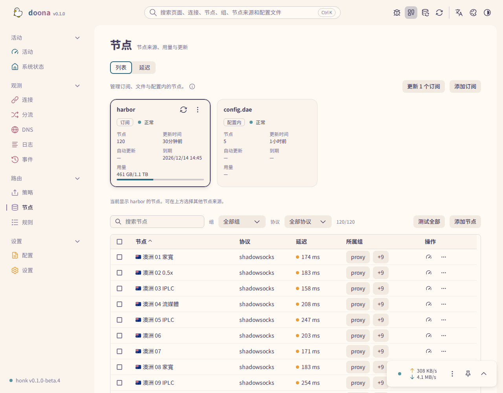
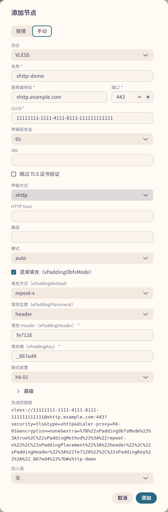
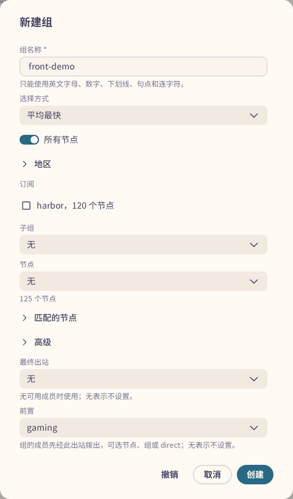

<div align="center">

# honk

**用 Rust 编写的实验性 Linux 透明代理引擎。**

**[文档](doc/README.md)** / **[网页界面示范](https://demo.daeuniverse.org/)** / **[下载](https://github.com/6106757-lab/honk/releases)**

[English](README.md) / 简体中文

[功能介绍](#功能介绍) / [本 fork 的定制内容](#本-fork-的定制内容) / [安装](#安装) / [配置书写格式](#配置书写格式) / [网页界面](#网页界面) / [报告问题](#报告问题)

</div>

> **早期 alpha，不建议用于生产。** 可能发生破坏性变更，部分功能尚未完成，真实环境验证仍然有限。

honk 的 eBPF 数据面和配置语法参考 dae 的设计，出站组与 Clash API 参考 sing-box 的设计。它是独立实现，并非任一项目的移植。本仓库是 [daeuniverse/honk](https://github.com/daeuniverse/honk) 的 fork，额外提供 MASQUE 出站、链式代理（detour）与定制版 doona 界面，见[本 fork 的定制内容](#本-fork-的定制内容)。

## 功能介绍

### 透明代理

- 通过 TC eBPF、`dae0`/`daens` 与编译路由，处理 LAN 转发流量与本机发起的 TCP/UDP。
- 域名嗅探（`dial_mode: domain` / `domain+` / `domain++`）与目的 IP 校验，按域名重新执行路由。
- 有歧义的 LAN UDP 经 NFQUEUE 320 暂存裁决（`global.nfqueue_enable`，默认开启）。
- 需要 root 权限、Linux 6.12+、所需内核选项与 bpffs。

### 出站协议

支持 SOCKS5、Shadowsocks/2022、Trojan、AnyTLS、Hysteria2、TUIC、Juicity、VMess、VLESS、`direct`、`block`，以及本 fork 的 MASQUE（connect-ip，见下）。

- Trojan / VMess / VLESS 支持 H2 XHTTP（`packet-up`、`stream-up`、`stream-one`）。
- XHTTP 支持混淆填充（obfuscation padding）的导入与发送，可对接 Cloudflare edgetunnel 一类入口；WS / XHTTP 的 Host 会用作 TLS SNI（未显式写 `sni` 时）。
- VLESS 支持 REALITY、Vision（`xtls-rprx-vision`）、XUDP 与多路复用；VMess 支持真正的 command-UDP（每个目标一条关联）。
- 前置 QUIC（fronted QUIC）接收上限 1452 字节；DoT（853）走 LAN 保护，不经过代理。

详见[协议限制](doc/zh/reference/nodes.md)。

### 组策略

Selector（默认）、URLTest、LoadBalance、Fallback、Score 五种策略。

- Selector：手动选成员，TCP 与 UDP 都跟随已选成员。
- URLTest：定时测延迟，选延迟最低的成员。
- LoadBalance / Fallback：按负载均衡或按顺序故障转移。
- Score：用业务观测与有界验证做选择，详见[组策略参考](doc/zh/reference/groups.md#score-策略)。
- 组可嵌套（`filter: group(X)`），可用 `final:` 指定无合格选择时的回退。

### DNS

- 上游支持 UDP、TCP、DoT、DoH、DoQ、DoH3，可经节点或组出站。
- 跟随策略（`-> follow`，本 fork 独有）：上游写 `-> follow` 时，DNS 查询走该域名内容流量所在的组（按域名/geosite 路由规则解析），DNS 出口与内容出口保持地域一致；解析到 `block` 的域名直接拒绝，解析到 `direct` 的按解析器 IP 路由。
- 请求路由与响应路由、缓存（仅缓存带有所查地址族地址的 NOERROR 正应答；NXDOMAIN / SERVFAIL / NODATA 等一律不缓存，过期正应答可 serve-stale 1 小时）。
- 支持 `ipversion_prefer`、`client_subnet`（`auto` 或固定值）、bootstrap 解析。

### 配置与控制

- dae 语法配置（见[配置书写格式](#配置书写格式)），支持订阅、`include {}` 拆分、SIGHUP 热重载。
- Clash 兼容 REST / WebSocket API 与原生 API（`/api/v1`），以及 `honk-tool` CLI 工具箱。
- 内置 doona 网页界面（`full` 构建），支持运行观测、诊断与配置编辑。

不提供 FakeIP 引擎、完整 mihomo 兼容性或 Windows/macOS 数据面。

## 本 fork 的定制内容

本仓库基于 [daeuniverse/honk](https://github.com/daeuniverse/honk)，额外提供以下功能。上游 `main` 目前不含这些内容；本仓库独立维护，问题请提交到[本仓库 Issues](https://github.com/6106757-lab/honk/issues)。

- **MASQUE（connect-ip）出站**：可从订阅导入 `type: masque` 节点（含 Cloudflare WARP），以 HTTP/2 或 HTTP/3 承载，支持 TUN 设备与内置界面延迟测试。详见[链式代理与 MASQUE 配置指南](doc/zh/guide/chained-proxy-and-masque.md)。
- **链式代理（detour）**：节点可写 `dialer-proxy`（Clash 订阅 / 分享链接）或 `detour`（sing-box JSON）；组可写 `detour:`，前置可为节点、组或 `direct`。组级前置每次拨号现解析，换前置热重载即生效，无需重启；`filter: group(X)` 的组自动继承上游组的 detour，显式 `detour:`（含 `direct`）可覆盖；未绑定的 detour 直接拒绝拨号，不悄悄走直连。TCP、UDP 拨号与 Clash / 原生 API 延迟测试共用同一解析。
- **XHTTP 混淆填充**：导入与发送 edgetunnel 风格的 XHTTP 填充字段（`xPaddingObfsMode/Method/Placement/Header/Key`），已在真实 edgetunnel 上验证通过。
- **DNS 跟随策略**：上游写 `-> follow`，DNS 查询走该域名内容流量所在的组，DNS 出口与内容出口保持地域一致。
- **内置定制版 doona 界面**：`full` 构建内置 [6106757-lab/doona](https://github.com/6106757-lab/doona) `v0.1.0` 编译的界面，支持 MASQUE 延迟测试与手动添加 XHTTP 节点（含 5 个混淆填充字段）。
- **现成二进制**：[Releases](https://github.com/6106757-lab/honk/releases) 提供已编译的 x86_64 与 aarch64 musl `full` 构建（tar.gz、deb、rpm、pkg.tar.zst），下载即可部署，不需要本地 Rust 编译环境。

## 安装

从[本仓库 Releases](https://github.com/6106757-lab/honk/releases)下载已编译好的归档。当前发布物为 x86_64 与 aarch64 Linux 静态 musl 的 `full` 构建（原生 API + Clash API + 内置 doona / doona lite），下载后可直接部署，不需要本地 Rust 编译环境。下表描述上游的构建矩阵，本仓库 Release 目前只发布 `full`。

| 构建 | 原生 API | Clash API | 内嵌 doona 与 doona lite |
| --- | --- | --- | --- |
| `full` | 是 | 是 | 是 |
| `native-api` | 是 | 否 | 否 |
| `clash-api` | 否 | 是 | 否 |

各构建均提供静态链接的 musl 版本，`full` 另提供链接 glibc 的 `gnu` 版本。名称含 `stock` 的归档使用系统分配器而非 jemalloc。每个版本的 Downloads 一节列出校验和及构建来源证明。

OpenWrt 用户可使用 [daeuniverse 软件源](https://openwrt.daeuniverse.org/zh-cn/)。

自行编译请按[从源码构建](doc/zh/how-to-start.md#从源码构建)准备。发布二进制内嵌 eBPF；仅执行 `cargo build --release` 不会启用真实数据面。

按[启动指南](doc/zh/how-to-start.md)检查内核、安装程序并验证连通性。首次部署会修改网络 hook、命名空间和 sysctl，须保留带外管理通道。

## 配置书写格式

honk 使用 dae 配置语法的方言。配置文件由若干 `section { ... }` 块组成，每行一个 `key: value`。完整字段清单见[配置指南](doc/zh/configuration.md)与各[参考文档](doc/zh/reference/)。

### 分段总览

| 分段 | 用途 |
| --- | --- |
| `global` | 选择接口、拨号行为、健康检查与运行时路径 |
| `node` | 用分享链接声明静态代理节点 |
| `group` | 在节点与嵌套组之间选择 |
| `routing` | 应用有序流量规则与默认出站 |
| `dns` | 配置监听、上游、请求/响应策略与缓存行为 |
| `subscription` | 获取远程节点列表 |
| `assets` | 为 geodata、外部 UI 和订阅设置下载默认值 |
| `experimental` | 启用原生 API、Clash API 或持久化缓存 |

内置出站 `direct` 与 `block` 会在启动时注入，可用于组和路由规则。

### 语法规则

- 配置项放在 `section { ... }` 块中，每行一个 `key: value`。也接受 `global { log_level: debug }` 这样的单行块，以及嵌套的单行块。
- 建议为 URL、含空白的值以及含 `:`、`+`、`#` 等语法字符的值加引号。标量值及 `include`、`node` 条目接受单引号或双引号；带引号的 `subscription` URL 使用单引号。
- 配置项或 matcher 接受列表时，用逗号分隔：`lan_interface: eth0, eth1` 或 `dport(80, 443)`。
- 以秒为单位的时长接受裸秒数或 `ms`、`s`、`m`、`h` 后缀。`check_tolerance` 等毫秒配置项接受裸毫秒数、`ms` 或 `s`。
- 引号外、词法单元开头的 `#` 引入注释；裸值内的 `#` 保留为数据。
- 未知标量键产生诊断并被忽略；未闭合的块会导致整个文档被拒绝。
- 用 `include {}` 拆分配置，支持 `*`、`?`、`[]` glob 模式，相对路径以入口配置所在目录为基准。

### 完整示例

```dae
# 全局：接口、拨号、健康检查。
global {
    wan_interface: auto
    lan_interface: br-lan
    log_level: info
    log_file: 'honk.log'
    dial_mode: domain++
    auto_config_kernel_parameter: true
    data_dir: '/var/lib/honk'
    tcp_check_url: 'https://www.gstatic.com/generate_204'
    tcp_check_http_method: HEAD
    check_interval: 300s
    check_tolerance: 30ms
}

# 静态节点：分享链接，tag 会成为路由/API 名称。
node {
    backup: 'socks5://192.0.2.2:1080'
    # 本 fork 独有：节点级前置，dialer-proxy 指定该节点拨号先经哪个前置。
    landing: 'vless://uuid@example.com:443?dialer-proxy=qianzhi#Landing'
}

# 订阅：远程节点列表。
subscription {
    mysub: 'https://example.com/sub' {
        interval: 3600s
    }
}

# 组：选成员、定策略、（本 fork）定前置。
group {
    qianzhi {
        filter: name('front-tw')
        policy: selector
    }
    Final {
        filter: name(keyword: 'WARP')
        policy: selector
        # 本 fork 独有：组级前置，前置可是节点名、组名或 direct，每次拨号现解析。
        detour: qianzhi
    }
    Proxy {
        filter: group(Final)
        policy: selector
        # 本 fork 独有：filter: group(Final) 的组自动继承 Final 的 detour，无需重复写。
    }
}

# 路由：按顺序匹配，fallback 为默认出站。
routing {
    dip(geoip: private) && !dport(53, 853) -> direct(must)
    domain(geosite: geolocation-cn) -> direct
    domain(geosite: geolocation-!cn) -> Proxy
    fallback: Final
}

# DNS：上游与请求/响应路由。
dns {
    upstream {
        direct_dns: 'udp://1.1.1.1:53' -> direct
        proxy_doh: 'https://dns.google/dns-query' -> Proxy
        # 本 fork 独有：跟随策略，DNS 查询走该域名内容流量所在的组。
        follow_dns: 'udp://8.8.8.8:53' -> follow
    }
    routing {
        request {
            qname(geosite: geolocation-cn) -> direct_dns
            fallback: proxy_doh
        }
        response {
            fallback: accept
        }
    }
}

# 实验性：原生 API 与 Clash API。
experimental {
    native_api {
        enabled: true
        listen: '127.0.0.1:9090'
        secret: 'replace-me'
        ui: 'embedded'
    }
    clash_api {
        external_controller: '127.0.0.1:9090'
        secret: 'replace-me'
    }
}
```

### 节点写法

每个 `node` 行都是分享链接：`tag: 'scheme://...'`。显式 tag 会成为路由/API 名称，并覆盖链接内嵌名称。凭据、TLS/REALITY、传输与协议调优项都放在链接的 userinfo 与 query 参数中。

```dae
node {
    # SOCKS5、VLESS、Trojan、VMess、Hysteria2 等均用分享链接声明。
    edge: 'socks5://192.0.2.2:1080'
    ws-node: 'vless://uuid@example.com:443?encryption=none&security=tls&type=ws&path=%2F&host=example.com#ws-node'
    # 本 fork：节点级前置用查询参数指定。
    landing: 'vless://uuid@example.com:443?dialer-proxy=qianzhi#Landing'
}
```

订阅里的节点写法：Clash / Mihomo YAML 写 `dialer-proxy: qianzhi`（也接受 `dialer_proxy` / `detour`）；sing-box JSON 写 `"detour": "qianzhi"`。

### 组写法

```dae
group {
    proxy {
        filter: name('edge')                    # 静态名称
        filter: subtag('mysub')                 # 订阅来源
        filter: group(Final)                    # 嵌套组
        policy: fallback                        # selector / urltest / loadbalance / fallback / score
        final: block                            # 无合格选择时的回退
        detour: qianzhi                         # 本 fork：前置节点名、组名或 direct
    }
}
```

- 多个 `filter:` 行表示 OR；同一行内 `&&` 表示 AND，`!` 对单个谓词取反。
- 没有过滤条件且没有嵌套组时包含全部节点；仅有嵌套组时不会自动包含全部节点。
- 本 fork：`filter: group(X)` 的组自动继承 X 的 `detour:`；显式 `detour:`（含 `direct`）可覆盖并停止继承；`final:` 不继承 detour。

### 路由写法

规则按源码顺序执行，目标可以是 `direct`、`block` 或组；裸节点名会在加载时被拒绝，须先将节点加入一个组。

```dae
routing {
    dip(geoip: private) && !dport(53, 853) -> direct(must)
    domain(suffix: example.com) -> proxy
    dport(80, 443) -> proxy
    fallback: direct
}
```

- `dip(...)` 按目的 IP / GeoIP 匹配，`domain(...)` 按域名 / geosite 匹配，`dport(...)` 按目的端口匹配；可用 `&&` 组合。
- `(must)` 决策是最终结果：跳过嗅探，且 Clash Global/Direct 模式不会覆盖 `must` 或 `block`。
- `fallback:` 为默认出站；失活出站通常 fail-closed，新流会被丢弃而不会泄漏到 `direct`。

### MASQUE 节点写法

MASQUE 主要经订阅导入（Clash YAML）：

```yaml
proxies:
  - name: "WARP"
    type: masque
    server: 162.159.199.2
    port: 443
    network: h2            # 或 quic，缺省 h2
    private-key: "..."     # WARP 设备私钥（Base64）
    public-key: "..."      # 端点公钥（可选）
    ip: 172.16.0.2         # 隧道内 IPv4；省略时由 ADDRESS_ASSIGN 分配
    ipv6: "..."            # 可选
    mtu: 1280              # WARP 常用值
    sni: "..."             # MASQUE 强制 TLS
```

也识别 `masque://host:port` 形式的手写分享链接。一个 MASQUE tunnel 就是一条到端点的 carrier 连接，每条路径各自持有 tunnel；节点级 detour 指向另一个 MASQUE 节点会被忽略并告警。

### 校验建议

1. 从仓库的 `config.min.dae` 或 `config.dae` 开始，替换其中的接口、端点与凭据。
2. 确保每个路由规则/`fallback`、DNS `fallback`、组 `final` 与 `->` 代理目标都指向已有的组、节点、`direct` 或 `block`。
3. 对首连域名规则使用 `dial_mode: domain`/`domain++`，或确保客户端 DNS 经过 honk 以填充域名路由 map。
4. 修改组或策略后，SIGHUP 会重建 `GroupManager`；仍有效的 Selector 选择会迁移到新的运行时代次。
5. 增加或修改配置 fixture 时，运行 `cargo test -p honk-config` 以保持解析器示例有效。

## 网页界面

honk 可配合以下两类网页界面使用：

- [doona](https://github.com/Zakkaus/doona)：基于原生 API，提供运行观测、诊断与配置编辑功能。doona lite 为其轻量预览版。在线演示见[标准版](https://demo.daeuniverse.org/)与 [lite 版](https://demo.daeuniverse.org/lite/)。本仓库 `full` 构建内置的是 [6106757-lab/doona](https://github.com/6106757-lab/doona) `v0.1.0` 编译的界面，支持对 MASQUE 节点做延迟测试。
- Clash 面板：基于 Clash 兼容 API，例如 [zashboard](https://github.com/Zephyruso/zashboard)。



手动添加 XHTTP 节点时可填 5 个混淆填充字段，并为节点指定链式前置：



新建组时可为整组指定前置（节点、组或 direct）：



使用 `full` 构建时，在 `experimental.native_api` 中将 `ui` 设为 `'embedded'` 即可启用 doona，设为 `'embedded-lite'` 则启用 doona lite。`native-api` 构建可将 `ui` 设为另行[安装的 doona](https://doona.daeuniverse.org/zh-CN/install.html) 所在目录。配置步骤见 [doona 快速入门](https://doona.daeuniverse.org/zh-CN/quick-start.html)。启用 Clash 面板需配置 `experimental.clash_api`，honk 首次启动时自动下载 zashboard。各设置项的说明见 [experimental 设置](doc/zh/reference/experimental.md)。

## 文档

[文档索引](doc/README.md)汇总中英文配置指南、原生与 Clash API 参考、子系统设计及运维指南。

## 版本与兼容性

- 自 `v0.1.0` 起，发布遵循 [SemVer](https://semver.org/lang/zh-CN/)；带 `-alpha.N`、`-beta.N` 或 `-rc.N` 后缀的标签为预发布。`1.0` 之前，次版本可能改变配置或行为，升级前应阅读发布说明。
- 透明代理需要 root 权限、Linux 6.12+、所需内核选项和 bpffs。详见上方链接的启动指南。
- 配置使用 [dae 语法](doc/zh/configuration.md)。修改已有部署前，请查阅 [NFQUEUE 运行说明](doc/zh/design/nfqueue.md)和 [VLESS 迁移指南](doc/zh/reference/nodes.md#从-vless_mode-迁移)。
- 原生 API 使用 `/api/v1`，其契约在 `1.0` 之前可能随次版本变化。`GET /api/v1/version` 返回契约标识。
- 本 fork 当前版本为 `v0.2.1`（2026-11-20），内嵌 doona `v0.1.0`。

## 开发

工作区包含配置、共享 eBPF 类型、NFQUEUE、出站、核心和工具 crate；`crates/honk-ebpf` 单独构建。详见 [Justfile](Justfile) 与[贡献政策](CONTRIBUTING.md)。

无 root 的用户态开发可使用 [mock 模式](doc/zh/how-to-start.md#无-root-开发)。`--mock-ebpf` 不会拦截流量，不能代替数据面测试。

本仓库的二进制由 GitHub Actions 构建，产物直接发布到 [Releases](https://github.com/6106757-lab/honk/releases)，无需本地编译环境；构建工作流见 [build.yml](.github/workflows/build.yml)，发布校验和随每个 Release 提供。

## 报告问题

代理、路由和 DNS 问题请提交至 [本仓库 Issues](https://github.com/6106757-lab/honk/issues)；内置界面问题请提交至 [doona fork Issues](https://github.com/6106757-lab/doona/issues)。上游专属功能的问题仍应提到 daeuniverse/honk。

安全漏洞请按 [SECURITY.md](.github/SECURITY.md) 报告。

## 致谢

- [dae](https://github.com/daeuniverse/dae) / daed-rs：eBPF 透明代理谱系
- [sing-box](https://github.com/SagerNet/sing-box)：出站组与 Clash API 模式
- [daeuniverse/outbound](https://github.com/daeuniverse/outbound)：协议参考
- [juicity-rs](https://github.com/juicity/juicity-rs)（Markson Pigeonzilla Plus）：Juicity 协议参考、wire 格式对齐及真实互通测试
- [aya-rs](https://github.com/aya-rs/aya)：Rust eBPF

## 许可证

[GPL-3.0-only](LICENSE)。

```text
SPDX-License-Identifier: GPL-3.0-only
Copyright (c) 2025, glassyiris <honk@catmint.cc> and honk contributors
```

仅用于开发的 [dae 解析器 oracle](tools/dae-parse/README.md)链接了 dae（AGPL-3.0-only）。它不随发布物分发，也不链接进 `honk-core`。

## TODO

- [ ] 评估 AF_XDP 与 XDP 路径以进一步提升性能
- [ ] 在 Clash 兼容 API 之外添加 honk 专用 REST API
- [ ] 添加入站支持
- [ ] 探索 macOS 与 Windows 支持；数据面基于 Linux eBPF，这两个平台需要另一种接管流量的方式
